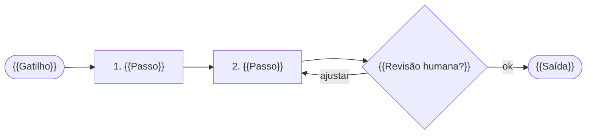

# {{ID}} — {{Título}}

> [!info] Ficha rápida
> **Endereço:** [[_Mapa {{Nome da equipe}}]] › {{Pasta do tipo}} › {{ID}}
> **Status:** 🟠 rascunho · **Versão:** 1.0.0 · **Responsável:** {{Nome}}
> **O que faz:** {{mesmo texto do resumo}}
> **Quando:** {{gatilho}} · {{frequência}}
> **Ferramentas:** {{Ferramenta 1, Ferramenta 2}}
> **Risco:** {{classificação — com 🔒 antes se restrito ou confidencial}} · Dados pessoais: {{sim/não}} · Revisão humana: {{sim/não}}

## 1. Objetivo e resultado esperado
- **Problema:** {{o que dói hoje, em uma frase}}
- **Resultado esperado:** {{o que muda quando funciona}}
- **Como saber que deu certo:** {{critério observável, ex. "fechamento até o 3º dia útil"}}

## 2. Gatilho e frequência
- **Gatilho:** {{o que inicia: e-mail recebido, dia do mês, pedido do gestor…}}
- **Frequência:** {{diária · semanal · mensal · sob demanda · por evento}}

## 3. Fluxo (visão rápida)


## 4. Entradas
| Entrada | Origem | Formato |
|---|---|---|
| {{…}} | {{…}} | {{…}} |

## 5. Passo a passo
| # | Ação | Quem / ferramenta |
|:-:|---|---|
| 1 | {{Verbo no imperativo + objeto}} | {{Pessoa ou ferramenta}} |
| 2 | {{…}} | {{…}} |

## 6. Saídas
| Saída | Destino | Quem usa |
|---|---|---|
| {{…}} | {{…}} | {{…}} |

## 7. Ferramentas e integrações
| Ferramenta | Função no processo | Conta / acesso |
|---|---|---|
| {{…}} | {{…}} | {{…}} |

## 8. Prompts utilizados
```text
{{Prompt usado, com variáveis entre chaves {assim}. Sem segredos. "Não se aplica." se não houver.}}
```

## 9. Dados e riscos
| Item | Situação e como é tratado |
|---|---|
| Dados pessoais | {{sim/não — tipos de dado (nunca valores), onde ficam, quem acessa}} |
| Segredos / credenciais | {{quais e em que cofre; no texto use o marcador SEGREDO}} |
| Revisão humana | {{sim/não — quem revisa a saída da IA antes de usar}} |
| Riscos conhecidos | {{alucinação, dado desatualizado, viés… e a mitigação de cada um}} |

## 10. Métricas
| Métrica | Antes | Depois |
|---|---|---|
| Tempo por execução | {{…}} | {{…}} |
| Volume por mês | {{…}} | {{…}} |

## 11. Exceções e o que fazer quando falha
| Situação | O que fazer | Contato |
|---|---|---|
| {{…}} | {{…}} | {{…}} |

## 12. Histórico de versões
| Versão | Data | Autor | Mudança |
|---|---|---|---|
| 1.0.0 | {{AAAA-MM-DD}} | {{Nome}} | Criação via skill rede-papaki |
